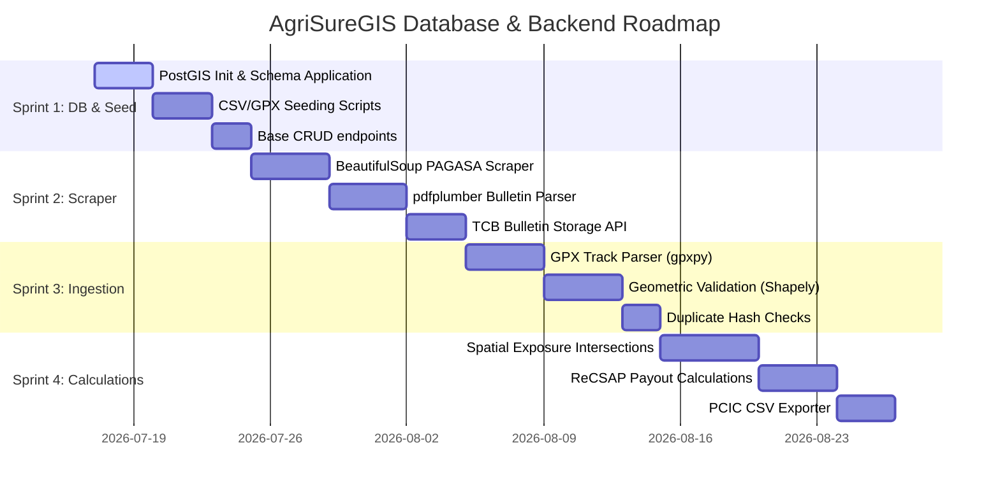

# AgriSureGIS — Backend & Database Development Workflow

This document outlines the step-by-step development workflow, database schema structure, and sprint execution plan for the **AgriSureGIS** database and backend API.

---

## 1. System Architecture Overview

The backend is built as a localized geoprocessing service designed to execute on PCIC Region X's local area network (LAN) to ensure data privacy.

```mermaid
graph TD
    subgraph Client Layer
        WebUI[React Frontend / Leaflet Map]
    end

    subgraph Service Layer (FastAPI Backend)
        API[FastAPI Router]
        Scraper[PAGASA Web Scraper]
        Parser[GPX & CSV ETL Pipeline]
        GeoEngine[GeoPandas / Shapely Spatial Engine]
    end

    subgraph Database Layer (PostgreSQL 15+ / PostGIS 3+)
        DB[(PostgreSQL Database)]
        GIS[(PostGIS Spatial Extension)]
    end

    WebUI -->|REST APIs| API
    Scraper -->|TCB PDFs| GeoEngine
    Parser -->|Polygons & Profiles| DB
    GeoEngine -->|Exposure & Payouts| DB
    DB <---> GIS
```

---

## 2. Relational Database Schema Design
All tables are prefixed with `tbl_` and mapped using SQLAlchemy / GeoAlchemy2. Fabio (DB Admin) is the custodian of these schemas.

Authoritative sources, in this order: [`backend/init_schema.sql`](../backend/init_schema.sql)
(the full current schema — every table below is created there),
[`backend/app/models/models.py`](../backend/app/models/models.py) (the ORM mapping),
and [`docs/ERD.drawio.png`](../docs/ERD.drawio.png). Incremental changes applied to an
already-populated database live in [`backend/migrations/`](../backend/migrations/) as
dated `.sql` files; each one has since been folded into `init_schema.sql`, so a fresh
apply needs only that file.

### Core data tables
1. **`tbl_system_users`**: Administrator and GIS Specialist accounts — bcrypt `password_hash`, `role`, `is_active` (false = pending approval), `last_login`, `session_timeout_minutes`.
2. **`tbl_farmers_profile`**: RSBSA-registered farmer profiles.
3. **`tbl_admin_boundaries`**: Geographical region codes and boundary details linked to the PSGC, plus `boundary_geom` (`Geometry(MultiPolygon, 4326)`) for the GeoServer/WFS boundary layer.
4. **`tbl_farms`**: Farmland details including spatial attributes (`location_geom` as `Geometry(MultiPolygon, 4326)`), `csv_farm_reference` (PCIC's own FARMID) and `georef_id`.
5. **`tbl_insurance_records`**: Insurance policies linking farmers, crops and coverages — `policy_no` (CIC NO), `amount_cover`, `program_type`, `effectivity_date`/`expiry_date`, `is_used`.
6. **`tbl_risk_assessment`**: The final output records storing the calculated payouts, the matrix rows used, crop stage and resolved `stage_group`.

### Reference / lookup tables
7. **`tbl_recsap_matrix`**: Static PCIC lookup of crop growth stage x TCWS signal x exposure hours to **estimated yield loss %**.
8. **`tbl_indemnity_factor_matrix`**: Second-step lookup of yield-loss bracket x PCIC crop-stage group to **indemnity factor**. Brackets are exclusive-lower/inclusive-upper.
9. **`tbl_crop_stage_mapping`**: Maps the source CSV's free-text stage labels onto `crop_stage_no` and PCIC's 5-group `stage_group` (added 2026-10-09). `panicle initiation/booting` is deliberately NULL — see `DEVELOPMENT_PLAN.md`'s Known gaps.

### Typhoon / bulletin tables
10. **`tbl_typhoons`**: Active and archived storms inside the Philippine Area of Responsibility (PAR); `is_active` tracks whether PAGASA's status page still lists them.
11. **`tbl_tropical_cyclone_bulletins`**: Multi-versioned bulletin logs parsed from PAGASA, storing the eye center (`center_geom` as `Geometry(Point, 4326)`), `is_final`, `forecast_track`, and the wind-circulation radii used by the track overlay.
12. **`tbl_tcb_signals`**: Regions/provinces/municipalities placed under specific TCWS signals, with `province` recorded from 2026-08-20 onward.
13. **`tbl_area_exposure_summary`**: Calculated exposure duration (hours) per administrative boundary, with `max_signal_level` and `is_eligible_6hr`.
14. **`tbl_parser_settings`**: The persisted TCB polling interval in minutes.

### Usage, audit and SAR tables
15. **`tbl_insurance_usage`**: Per-typhoon usage of a policy — `is_used`, `assessment_id`, `marked_at`, and `finalized_at` once a final PABS export locks it. Unique per (policy, typhoon), so the same policy can be used for one typhoon and unused for another.
16. **`tbl_activity_log`**: Every login, logout and mutating API call, with the acting `user_id`, endpoint and status code.
17. **`tbl_planted_verification`**: The GIS Specialist's manually recorded planted verdict (SAR Phase 1). Unique per (farm, typhoon).
18. **`tbl_sar_observation`**: Cached per-farm, per-scene polygon-mean Sentinel-1 VV/VH values.
19. **`tbl_sar_fetch_coverage`**: Which date window each farm's SAR observations already cover, so Earth Engine is only queried for gaps.
20. **`tbl_sar_planted_check`**: The automatic planted check's result per (farm, typhoon) — `status` (`planted`/`field_verify`) and `reason_code`.

### Views
21. **`mv_farm_latest_insurance`** (materialized view, not a `tbl_`): "most recent policy per farm", so `GET /api/farms/` resolves it in one indexed lookup instead of per-row queries. Created by `migrations/2026-08-09_farms_perf.sql` and `init_schema.sql`; the farms endpoint falls back to a Python reduction if it is absent.


---

## 3. Sprint Roadmap



> **Status note (2026-10-18).** All four sprints below are substantially
> complete; the Gantt dates above are the original plan, not a current
> schedule. Do not read "Sprint 1" as the current sprint — see
> `.claude/DEVELOPMENT_PLAN.md` for per-task status and for the shipped work
> that no sprint here covers (auth, user management, activity log, SAR/Earth
> Engine, email alerts).

### Sprint 1: Database Setup & Seed Ingestion
* **Objective:** Establish the localized database, apply schemas, and seed baseline profiles.
* **Step-by-Step Backend Tasks:**
  1. **Provision DB:** Enable PostGIS extension: `CREATE EXTENSION IF NOT EXISTS postgis;`
  2. **Apply Schema:** Apply [init_schema.sql](../backend/init_schema.sql) containing constraints, foreign keys, and spatial indices (`GIST` index on `tbl_farms.location_geom`).
  3. **Write DB Models:** Map SQLAlchemy models in `app/models/models.py`.
  4. **Seeding Script:** Complete `seed_database.py` to ingest legacy `pabs_results.csv` and normalize records into `tbl_farmers_profile` and `tbl_insurance_records`.
  5. **Base API:** Expose CRUD routes for farmers and policies.

### Sprint 2: PAGASA bulletin Parser & Scraper
* **Objective:** Automate the acquisition and storage of typhoon warning bulletins.
* **Step-by-Step Backend Tasks:**
  1. **Web Scraping:** Build an asynchronous task using `httpx` and `BeautifulSoup4` to crawl the PAGASA active bulletins index page.
  2. **PDF Downloader:** Download TCB bulletin PDFs programmatically and store them locally (archived to prevent loss when PAGASA purges files).
  3. **Data Extraction:** Use `pdfplumber` to extract:
     - Bulletin number, issue date/time, and expiry date.
     - Storm coordinates (center latitude/longitude).
     - Affected municipal list sorted by Tropical Cyclone Wind Signal (TCWS 1 to 5).
  4. **Bulletin API:** Endpoint `/api/bulletins/parse` to trigger scraping and return parsed JSON.

### Sprint 3: GPX Parser & Spatial Boundary Processing
* **Objective:** Ingest farm boundaries and check coordinate topologies.
* **Step-by-Step Backend Tasks:**
  1. **GPX Ingestion:** Endpoint `/api/upload/gpx` accepting `.gpx` files; endpoint `/api/upload/gpkg` accepting a `.gpkg` GeoPackage of many farm polygons (the client's real data format, added 2026-10-08).
  2. **GPX Parsing:** Use `gpxpy` to parse trackpoints (Lat, Lon, Elevation) from GPX files.
  3. **Geometry Construction:** Convert coordinate streams into Shapely `Polygon` structures.
  4. **Coordinate Transformation:** Standardize all coordinates to WGS 84 (SRID 4326) using `pyproj` and `GeoPandas`.
  5. **Boundary Duplicate Check:** Hash the coordinate stream cryptographically (SHA-256) to ensure no farmer uploads identical geometries.
  6. **Spatial Insertion:** Write polygons into `tbl_farms.location_geom` via GeoAlchemy2.

### Sprint 4: Spatial Overlay & Parametric Calculations
* **Objective:** Perform geoprocessing to determine risk exposure and payout amounts.
* **Step-by-Step Backend Tasks:**
  1. **Typhoon Path Overlay:** Intersect the storm trajectory buffer with farm coordinates in PostGIS.
  2. **Calculate Exposure Hours:** Sum the duration (in hours) that a municipal boundary was exposed to a specific TCWS signal:
     $$\text{Exposure Duration} = \sum (\text{expires\_at} - \text{issued\_at})$$
  3. **Check Payout Eligibility:**
     - Must belong to wind signal $\ge 2$.
     - Exposure duration must be $\ge 6$ hours.
     - Verify crop growth stage is in Booting, Flowering, or Maturity.
  4. **Run Payout Engine:** Apply the formula:
     $$I = \left(\frac{AC}{1000}\right) \times IF$$
     - **Farm area is not a factor.** An earlier `\times \text{Area}` variant was
       documented here; it was corrected with Fabio on 2026-07-23 and is wrong.
       See `app/core/indemnity_calc.py`'s `calculate_final_payout`.
     - $IF$ (Indemnity Factor) comes from a **two-step** lookup, not one table:
       `tbl_recsap_matrix` gives the estimated yield loss % for
       (crop stage, TCWS signal, exposure hours), then
       `tbl_indemnity_factor_matrix` gives the factor for
       (yield-loss bracket, PCIC crop-stage group).
     - Exposure hours are bucketed **down** to the matrix's discrete brackets
       (6 / 12 / 24); anything under 6 hours yields no rule and no payout.
  5. **PCIC CSV Export:** Package results into a final CSV report appended to original row layouts for the PCIC Finance Division.

---

## 4. Resetting the Local Database

[init_schema.sql](../backend/init_schema.sql) starts with `DROP TABLE IF EXISTS
... CASCADE` for every `tbl_*` table, so re-running it against an existing
database *is* the reset — it drops and recreates every table empty (the
`CREATE TABLE` statements right below the drops rebuild the schema). It does
not touch the `agrisure_db` database or `agrisure_admin` user themselves.

**Fabio runs these himself** — DB superuser credentials and `sudo`/`psql`
access live only in his environment (see `CLAUDE.md`'s Database Command
Execution rule):

1. Re-apply the schema (drops + recreates every table, empty):
   ```bash
   cd backend
   psql -U agrisure_admin -d agrisure_db -h localhost -f init_schema.sql
   ```
   If the database is already populated and you'd rather **not** wipe it, apply
   only the dated files in [`backend/migrations/`](../backend/migrations/) that
   it hasn't seen yet — each one is the incremental `ALTER`/`CREATE` equivalent
   of a schema change that has also been folded into `init_schema.sql`.

2. Reload whichever data you want back. **The quickest path is
   `python seed_all.py`**, which runs the whole sequence below in the right
   order in one process (it deliberately does *not* run `init_schema.sql`
   itself — that's step 1, your terminal). Individually, in dependency order:
   - `python seed_admin_boundaries.py` — every barangay in
     `app/data/psgc_nationwide_boundaries.csv` into `tbl_admin_boundaries`
     (needed so PAGASA TCWS areas anywhere in the country resolve to a
     boundary). Regenerate that CSV first from PSA's PSGC Publication with
     `python scripts/convert_psgc_publication.py --inspect <xlsx>`, then
     `python scripts/convert_psgc_publication.py <xlsx>`.
   - `python seed_database.py` — legacy `pabs_results.csv` farmers/insurance,
     plus the PSGC admin boundaries those farms need.
   - `python seed_system_users.py` — the login accounts. **Nothing can log in
     without this**, since authentication became real (2026-08-16); it is
     idempotent and skips emails that already exist.
   - `python backfill_admin_boundary_geom.py` — backfills `boundary_geom` on
     `tbl_admin_boundaries`, needed for the GeoServer/WFS boundary layer in
     Spatial Analysis (see `.claude/GEOSERVER_SETUP.md`).
   - `python seed_active_insurance.py` — adds synthetic *active* insurance rows
     (~1,000) so the active-insurance views aren't empty. Development aid only;
     do not run it on anything presented as real PCIC data.
   - `python prepare_ingestion_demo.py` (or `reset-demo-data.bat` from the repo
     root) — the one-click ingestion-demo reset: splits the client's real
     export in half per farmer, clears the farmer-side tables, and pre-ingests
     one half through the same code paths `/api/upload/csv` and
     `/api/upload/gpkg` use, leaving the other half to upload live in the UI.
   - For typhoon data, see [`backend/simulation/README.md`](../backend/simulation/README.md)
     — it replays Typhoon OPONG's 23 real PAGASA bulletins through the app's
     own parser. The old fictional-storm seeders (`mock_data/seed_mock_typhoon.py`
     — MARISOL, and its ALBRITCH sibling) were deleted on 2026-10-13 now that
     the real exports are available; recover them from git history if ever needed.

If the database/user don't exist at all yet (fresh machine), see the
Quickstart in the repo root [README.md](../README.md) instead.
